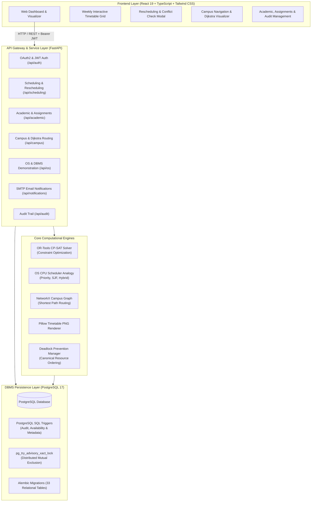
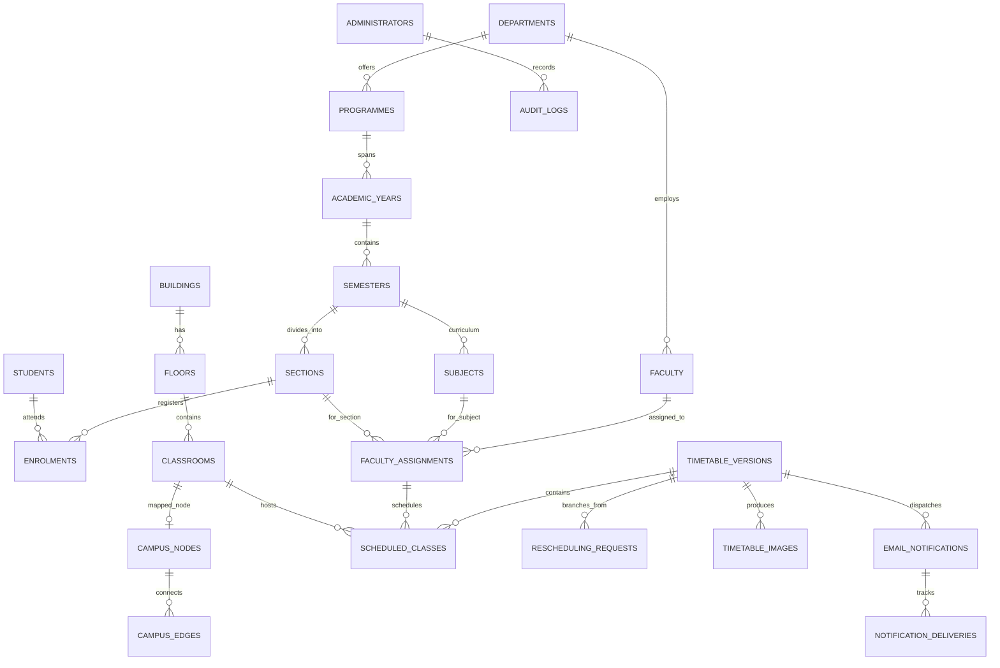

# Schedulix — University Timetable Management System

Schedulix is an enterprise-grade university timetable management and optimization system designed to automate conflict-free schedule generation while demonstrating core principles of **Database Management Systems (DBMS)**, **Operating Systems (OS)**, **Constraint Satisfaction Programming (OR-Tools CP-SAT)**, and **Graph Theory (NetworkX Dijkstra)**.

---

## 1. System Architecture



---

## 2. Relational Database Schema & Mermaid ER Diagram

Schedulix enforces strict Third Normal Form (3NF) relational integrity across 33 tables with composite unique constraints, cascading foreign keys, and indexes on all search and scheduling predicates.

### Mermaid ER Diagram



### Key Entities
- **Academic Entities**: `departments`, `programmes`, `academic_years`, `semesters`, `sections`, `subjects`.
- **People**: `administrators`, `faculty`, `students`, `enrolments`.
- **Campus**: `buildings`, `floors`, `classrooms` (with equipment/capacity), `campus_nodes`, `campus_edges`.
- **Scheduling**: `faculty_assignments`, `faculty_availability`, `room_availability`, `timetable_versions`, `scheduled_classes`, `rescheduling_requests`.
- **Management & OS Control**: `scheduling_locks`, `audit_logs`, `email_notifications`, `notification_deliveries`.

---

## 3. Human-Readable Automatic Identifiers

Identifiers are generated safely using transactions and format constraints:
- **Subjects**: Semester and department prefix aware (e.g. `CS-104`, `CS-401`, `ECE-301`).
- **Faculty**: Department prefixed sequential identifier (e.g. `CE-FAC-001`, `CSE-FAC-002`).
- **Classrooms**: Campus hierarchy encoded (e.g. `CE-B1-F1-R101`).
- **Students**: Year of admission + sequential serial (e.g. `2024001`, `240212377`).

---

## 4. API Endpoints Structure

Schedulix provides full OpenAPI/Swagger documentation accessible at `http://localhost:8001/docs`:

### Authentication (`/api/auth`)
- `POST /api/auth/login`: JSON authentication for frontend dashboard.
- `POST /api/auth/token`: OAuth2 password request form for Swagger UI authorization.

### Academic & Faculty Assignments (`/api/academic`)
- `GET /api/academic/stats`: System-wide metric counters (faculty, students, rooms, assignments, schedules).
- `GET /api/academic/departments`: Departments list.
- `GET /api/academic/programmes`: Programmes list.
- `GET /api/academic/semesters`: Semesters list.
- `GET /api/academic/sections`: Sections list.
- `GET /api/academic/subjects`: Subjects list.
- `GET /api/academic/faculty`: Faculty members list.
- `GET /api/academic/assignments`: Enriched faculty-subject-section assignments.
- `POST /api/academic/assignments`: Create verified faculty assignment with clash validation.
- `PATCH /api/academic/assignments/{id}`: Toggle assignment active status.
- `DELETE /api/academic/assignments/{id}`: Safely remove assignment.

### Campus Navigation & Dijkstra Shortest Path (`/api/campus`)
- `GET /api/campus/buildings`, `GET /api/campus/floors`, `GET /api/campus/rooms`: Physical campus hierarchy.
- `GET /api/campus/nodes`, `GET /api/campus/edges`: Graph topology elements.
- `GET /api/campus/graph-data`: Visualization-ready node and edge data.
- `GET /api/campus/route-between-rooms`: Computes NetworkX Dijkstra shortest path, total distance in meters, and estimated walking minutes between any two classrooms.

### Timetable Generation & Rescheduling (`/api/scheduling`)
- `POST /api/scheduling/generate`: Synchronous OR-Tools CP-SAT timetable solver execution.
- `POST /api/scheduling/generate-async`: Celery background worker timetable generation.
- `GET /api/scheduling/versions`: Historical and active timetable versions.
- `GET /api/scheduling/versions/{version_id}`: Comprehensive schedule view with complete academic metadata.
- `POST /api/scheduling/versions/{version_id}/approve`: Administrative review and approval.
- `POST /api/scheduling/versions/{version_id}/publish`: Atomic publication with row-level locking.
- `POST /api/scheduling/check-conflict`: Dry-run clash detection before moving a class.
- `POST /api/scheduling/versions/{version_id}/manual-reschedule`: Manual reschedule with conflict validation and version branching.
- `POST /api/scheduling/versions/{version_id}/images`: Renders high-resolution weekly section and faculty PNG files.
- `GET /api/scheduling/versions/{version_id}/images-list`: List of rendered PNG files with persistent paths.
- `GET /api/scheduling/images/{image_id}/download`: Direct binary PNG download.

### Email Notifications (`/api/notifications`)
- `GET /api/notifications/status`: SMTP server configuration state.
- `POST /api/notifications/send/{version_id}`: Dispatches timetable PNGs to enrolled students and faculty with duplicate-send prevention.
- `GET /api/notifications/history`: Full notification dispatch log.

### OS & DBMS Demonstration (`/api/os`)
- `GET /api/os/concepts`: Detailed breakdown of CPU scheduling, semaphores, deadlock prevention, and triggers.
- `GET /api/os/semaphore/status`: Live state of Python binary semaphore and PostgreSQL advisory lock.
- `POST /api/os/semaphore/test-concurrency`: Simulates critical section hold with mutual exclusion.
- `POST /api/os/deadlock/test-prevention`: Demonstrates Circular Wait elimination via canonical resource ordering.

### System Audit Trail (`/api/audit`)
- `GET /api/audit/logs`: Filterable audit trail tracking administrative actions and SQL trigger events.

---

## 5. Local Installation & Setup Instructions

### Prerequisites
- Python 3.12+ (or 3.13)
- Node.js 20+
- PostgreSQL 16+
- Redis 7+

### Step-by-Step Setup

1. **Clone the Repository**:
   ```bash
   git clone <repo-url>
   cd Schedulix
   ```

2. **Backend Setup**:
   ```bash
   python3 -m venv .venv
   source .venv/bin/activate
   pip install -r backend/requirements.txt
   ```

3. **Configure Environment Variables**:
   Copy the `.env` template:
   ```bash
   cp .env.example .env
   cp .env backend/.env
   ```
   Ensure `DATABASE_URL`, `SECRET_KEY`, and `ADMIN_PASSWORD` are defined.

4. **Run Alembic Database Migrations & SQL Triggers**:
   ```bash
   cd backend
   alembic upgrade head
   psql -d schedulix -f triggers.sql
   ```

5. **Seed Database with Sample University Data**:
   ```bash
   python -m app.seed
   cd ..
   ```

6. **Start Backend Server**:
   ```bash
   PYTHONPATH=backend .venv/bin/uvicorn app.main:app --host 0.0.0.0 --port 8001 --reload
   ```

7. **Frontend Setup & Execution**:
   ```bash
   cd frontend
   npm install
   npm run dev
   ```
   The frontend runs at `http://localhost:5174` and proxies `/api` and `/media` to the backend.

---

## 6. Docker Deployment

Schedulix includes multi-container Docker Compose orchestration:

```bash
docker compose build
docker compose up -d
```

Containers:
- `schedulix-db`: PostgreSQL 17 database with persistent volume.
- `schedulix-redis`: Redis 7 message broker and cache.
- `schedulix-backend`: FastAPI application and OR-Tools engine (`http://localhost:8000`).
- `schedulix-celery`: Asynchronous background task worker.
- `schedulix-frontend`: React production build served via Vite (`http://localhost:5173`).

---

## 7. Running the Automated Test Suite

Schedulix includes comprehensive tests covering unit logic, constraints, campus Dijkstra routing, CPU scheduling, email notifications, concurrency, and live E2E workflows:

```bash
# Run complete test suite (31 tests across 5 test suites)
PYTHONPATH=backend .venv/bin/pytest tests/ -v

# Run the live 16-step end-to-end integration verification
PYTHONPATH=backend .venv/bin/python3 test_live_system.py
```

---

## 8. University Workflow Operations

### 8.1 Generating a Timetable
1. Navigate to the **Timetable** view in the web dashboard or execute `POST /api/scheduling/generate`.
2. Configure the CPU scheduling strategy (`PRIORITY`, `SJF`, or `HYBRID`) and weights (e.g. 65% Priority / 35% SJF).
3. The OR-Tools CP-SAT solver executes with time-slice indexed constraints, yielding an `OPTIMAL` or `FEASIBLE` conflict-free schedule in seconds.

### 8.2 Rescheduling & Conflict Checking
1. In the timetable grid or modal, choose any session to reschedule.
2. The system executes a live conflict check against operating hours, room capacity, room clashes, faculty clashes, and section clashes.
3. If valid, the move is committed via an atomic transaction, creating an audited child version branch.

### 8.3 Rendering PNG Timetables
1. Click **Export Timetables** or trigger `POST /api/scheduling/versions/{version_id}/images`.
2. Pillow generates customized, high-contrast weekly grid PNG images for every section and faculty member with canonical filenames (e.g. `CE_BTECH-CE_SEM3_SECTION_A_2026-2027.png`).

### 8.4 Dispatching Timetables via Email
1. Click **Email Timetables** or execute `POST /api/notifications/send/{version_id}`.
2. The notification service queries all enrolled students and faculty members, verifies duplicate-send records, attaches the corresponding PNG file, and sends emails via SMTP (with live fallback simulation and delivery logging).
